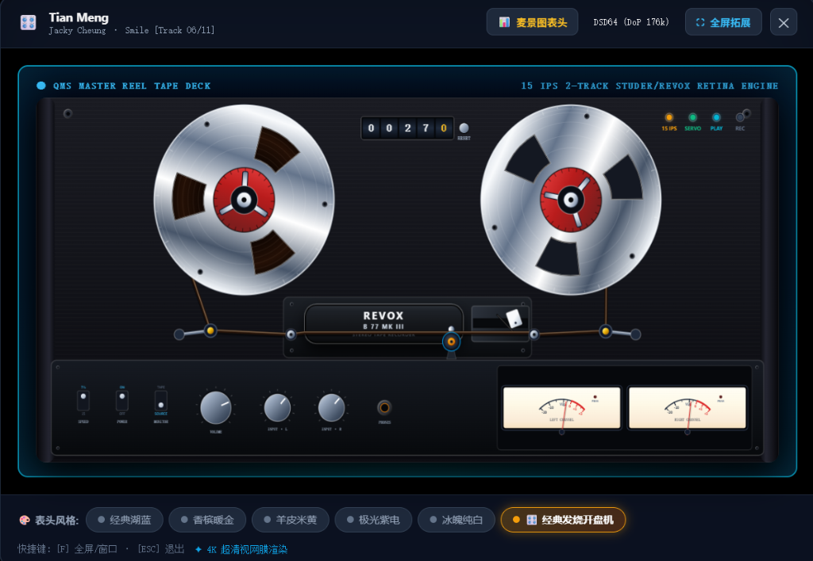
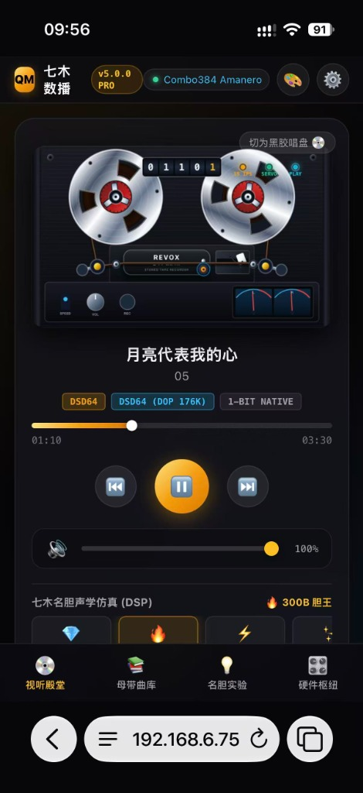
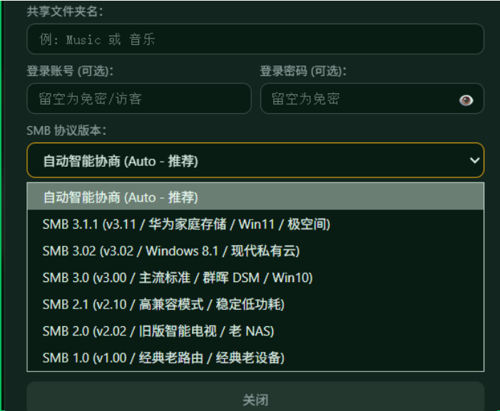

# QMS Audio OS v5.0.0 PRO 旗舰正式版 · 官方发布通告

> **“让母带磁带在屏幕上流动，让模拟声的温暖直击发烧灵魂。”**

经过数月的深度底层重构、视觉粒子渲染打磨与声学严苛实测，备受发烧乐友期待的 **【QMS Audio OS v5.0.0 PRO 旗舰正式版】** 今日正式震撼发布！

本次升级不仅重磅推出了致敬录音室传奇的 **4K 纯矢量母带开盘机走带台**，更全面打通了**全屋手机无线无损投流中枢（AirPlay / DLNA）**、**华为家庭存储与现代私有云 NAS 深度自省与挂载自愈**，以及**名胆声学仿真与双端物理绝对隔离架构**。


---

## 🔥 旗舰亮点 01：【男人的终极浪漫】致敬传奇 Revox B77 · 4K 纯矢量母带开盘机走带台

*每个发烧友心里，都住着一台永不停歇的开盘机。*



*   **10.5 英寸专业 NAB 铝合金开盘卡爪**：
    致敬录音室传奇 Studer / Revox B77 经典美学，采用 4K 纯矢量粒子微表面光影算法，雕琢航空级拉丝阳极氧化铝法兰、三叶镂空导带窗与红金 NAB 锁扣。
*   **物理级磁带动态解算与流体走带**：
    供带盘（左）与收带盘（右）的磁带厚度与转动角速度**与歌曲真实播放进度 1:1 动态耦合**——开盘转动时，左盘由厚变薄、右盘由薄变厚，带头压带轮、精密导向辊丝滑穿带。
*   **PC 专业大屏与手机轻奢端双端适配**：
    *   **PC 桌面端**：右上角一键在【麦景图双表头】与【开盘机走带台】之间热切换，支持点击放大至全屏沉浸视听室模式；
    *   **手机轻奢端**：旋转大黑胶一键翻转为流光开盘机，120Hz 高刷防抖丝滑运转，伴随动态 RMS 分贝指针起伏跳动。



---

## 🚀 旗舰亮点 02：手机无线音频投流中枢 (AirPlay / DLNA 无损直通)


*   **免 App 投流秒级发现**：
    iPhone / iPad 控制中心与网易云音乐、QQ 音乐等一键投流，16bit / 44.1kHz ALAC 纯净母带源码直通推流。
*   **全自动网络拓扑与时序自愈**：
    彻底攻克开机冷重启 D-Bus 断链与旧版 `localhost` 域名拒绝冲突难题，无论冷重启还是网络重连，投流中枢 **100% 自动秒级上线**。

---

## 🌐 旗舰亮点 03：华为家庭存储与现代私有云 NAS 深度自省与挂载自愈



*   **消除底层 CIFS 内核参数冲突**：
    彻底根治现代私有云 NAS 常见的 `iocharset=utf8` 参数冲突（错误码 22），彻底解决华为家庭存储拒连难题。
*   **SMB 3.1.1 / 3.0 / 2.1 协议全能自适应握手**：
    双端界面专属【SMB 协议版本】下拉选择框，支持自动智能协商与指定版本强连，Base64 参数无损编码，特殊密码永不截断。

---

## 🎛️ 旗舰亮点 04：发烧声学核心与双端物理绝对隔离架构


*   **名胆谐波与发烧均衡**：
    300B（胆王）、KT88、ECC83、2A3、EL34 等 6 大名胆毫秒级热切换与 10 段专业录音室 64-bit 浮点 IIR 均衡器。
*   **双端物理绝对隔离**：
    PC 宽屏专业端（`index.html`）与手机流体轻奢端（`v2.html`）各自独立优化，严禁混杂。

---

## 📦 官方安装与升级标准指引

```text
【新装设备建议路径】
1. 制作 Live USB，写入 QMS v4.2.2b 基础安装介质（内置 APE/FLAC 完整解码器与驱动底盘）；
2. 一键安装到机器内置固态硬盘；
3. 开机进入控制台，上传 QMS-Upgrade-v5.0.0-PRO.qpkg 升级包，一键无感升级到 5.0.0 PRO！
```

---

## 📥 官方下载分流通道

👉 **[点击这里直接打开百度网盘下载 QMS Audio OS v5.0.0 PRO 系统镜像与升级包](https://pan.baidu.com/s/1j445htW_LeFTTpcvyGT-cQ?pwd=qmsb)**
*   **网盘提取码**：`qmsb`
*   如需获取老用户终身技术支持、进入专属发烧研讨群或预约一对一远程协助，可直接添加站长微信：**`wxcq888`**。

---

**祝各位乐友听音愉快，频出好声！** 🎶
