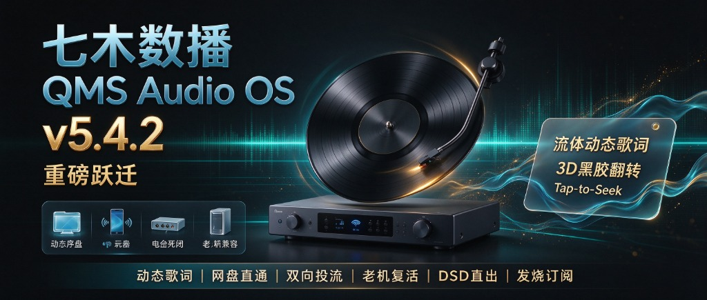

# 🎵 七木数播 QMS Audio OS 迎来重磅跃迁：从 v5.1.3 到 v5.4.2，我们做了哪些发烧级蜕变？

> **引言**：  
> 自 QMS Audio OS **v5.1.3** 获得众多发烧友与商业订户的认可之后，七木研发团队在过去这段时间里，没有放慢脚步，而是针对烧友们反馈最热切的痛点——**“听歌能不能有高颜值动态歌词？”、“能不能不买昂贵吵闹的 NAS？”、“手机投流能不能秒开？”、“老主机与低功耗工控机能否满血复活？”**——进行了一场贯穿声学底层、网盘流媒体、动态歌词视觉与引导架构的全链路重构。  
> 
> 今天，**QMS Audio OS v5.4.2 商业发烧版独立安装镜像**正式面向全网发烧友亮相！一起来看看这次跨越式升级带来的六大核心惊喜与诚意满满的订阅方案。

---

### 🎤 亮点一：震撼视觉！Apple Music 级流体动态歌词与 3D 黑胶翻转

以前用传统数播听母带，屏幕上往往只有单调的文件名或冰冷的信息行。从 5.1.4 开始，QMS 迎来了数播领域颜值天花板级别的**发烧动态歌词与深度元数据系统**：

* 💿 **手机端黑胶 3D 翻转卡片**：在手机流体轻奢端（v2），轻触正在旋转的复古黑胶唱盘，唱片会以 3D 拟真动效优雅翻转，瞬间切换为全屏沉浸式流体歌词！背景伴随专辑封面色彩流动的弥散光斑，逐行平滑居中滚动，质感媲美 Apple Music；
* 🎚 **PC 桌面端 Studio 录音室剧院模式**：大屏端支持【麦景图双表头】、【复古开盘机转动】与【巨幕动态歌词】三模态一键无缝切换！更有六维发烧指标（位深、采样率、实时码率、容器、声道）动态悬浮；
* 👉 **Tap-to-Seek 触摸点播**：在手机或 PC 屏幕上点到哪一行歌词，底层播放器毫秒级瞬间跳转（Seek）到该句发声，跟唱、赏词随心所欲；
* 🧠 **全网智能自动匹配 + 本地永久落盘缓存**：本地有 `.lrc` 优先读本地；没有歌词时，服务端全自动从云端精准检索、简繁体智能互转，抓取后自动缓存到数播本地，第二次播放零等待、免流量秒开！

---

### 💥 亮点二：干掉 3000 元 NAS！百度/阿里网盘直通秒开

很多烧友入门数播的第一步就被劝退了：一台群晖/威联通双盘位加上两块发烧级红盘，随随便便就奔着 **2500～3500 元** 去了；放在听音室里 24 小时开机，机械硬盘寻道的“炒豆声”和风扇噪音，在夜深人静听人声弦乐时更是发烧大忌。

**在 v5.4.2 中，QMS 重构了纯 C++ 原生网盘调度引擎：**
* ⚡ **转存即听，告别挂机下载**：烧友圈分享的 24bit/192kHz 母带、SACD ISO 珍藏，在网盘里一键转存，QMS 即可瞬间识别并秒开播放！
* 🚀 **HTTP Range 毫秒级直通切片**：根本不需要把整张 800MB 的专辑下载到本地，专核流式直通 ALSA 声学底层，点击即响；
* 💰 **精明算笔账**：省下买 NAS 的三千块，够充 10 年网盘 SVIP，坐拥 5TB～10TB 海量空间，零坏道风险、零噪音、零维护心智负担！

---

### 📱 亮点三：手机双向发烧投流！AirPlay 与 DLNA 专核直出

想听手机上 QQ 音乐、网易云、Apple Music 的独家版权歌曲，又舍不得数播的高素质声卡和胆管模拟味？

* 📲 **全系无线投流中枢就绪**：iPhone / iPad / Mac 用户轻点 **AirPlay**，安卓用户轻点 **DLNA / QPlay**，无需插线，瞬间将无损母带投射给 QMS；
* 🎛 **发烧级伴随渲染**：手机投流依然走独立音频调度通路，前级麦景图湖蓝色双表头分贝电平依然优雅跳动，发烧仪式感分毫不减；
* 📡 **局域网设备自省**：新增局域网智能音响、达菲（Daphile/LMS）发烧硬件的主动探测与外发中枢，一机统领全屋发烧设备。

---

### 🖥 亮点四：老主机与工控机满血复活！MBR 双模极限兼容

发烧友手头闲置的旧笔记本、或者百元级 HP T620 / 瘦客户机工控机，是做独立纯音数播的绝佳载体。但以往这类设备往往只有 14G/16G mSATA 小硬盘，且主板只支持传统 Legacy MBR 引导。

* 🛠 **MBR + UEFI 双模自适应架构**：全面攻克了工控机“No boot disk detected”与老机器找不到引导的顽疾，14GB 极限小硬盘也能独立拔掉 U 盘冷启动；
* 🔄 **全新“就地无损升级”架构**：安装程序能够智能检测目标大硬盘中已有的 QMS 系统，升级时只更新系统核心分区，完整保留原有机内几万首曲库与网络设置！

---

### 🎚 亮点五：原生 DSD 直通与内核级物理声卡“防串音”死锁

在底层声学架构上，v5.4.2 贯彻了严苛的“纯净源码直出（Bit-Perfect）”原则：
* 🎼 **Native DSD / DoP 双模全打通**：修复了 DSD 模式即时生效与声卡硬件能力自检，硬解直通不掉频；
* 🔒 **声卡物理死锁机制**：彻底根治了多任务切歌时，外置 USB 高级解码器与电脑自带喇叭同时发声的“串音”尴尬，锁定发烧 DAC 独占输出；
* 🔌 **内核级硬件电源按键守护（qms-powerkeyd）**：轻按主机机箱物理电源键，毫秒级捕获并执行 OpenRC 安全平滑关机，彻底告别误拔电源导致的固件损伤。

---

### 💎 七木发烧尊享计划（极具诚意的订阅方案）

相比动辄大几千、上万元的封闭式发烧硬件与国外商业授权，七木数播坚持做真正让大众烧友“用得爽、听得起”的国民级发烧系统。我们推出了极为亲民、丰俭由人的订阅体系：

| 方案级别 | 尊享价格 | 适合人群与专属权益 |
| :--- | :---: | :--- |
| **🎁 新用户体验** | **免费** | 首次装机可一键申请 **3 天全功能免费试用**，零成本上车体验发烧听感 |
| **☕ 尝鲜月卡** | **¥9.9 / 月** | 一杯奶茶钱，全功能解锁！适合短期折腾、试水把玩或展会临时用机 |
| **🌟 超值年卡** | **¥99 / 年** | 折合每天仅需 **0.27 元**！发烧友年度省心之选，支持 7 天脱机离线畅听 |
| **👑 终身尊享 VIP** | **¥299 (一次买断)** | **最受硬核烧友青睐的终身方案！** 一顿火锅钱永久买断，尊享永久免联网离线畅听、终身免费享受后续所有大版本迭代升级！ |

> 💡 **贴心提示**：所有授权均绑定主机物理硬件特征（Machine-ID）。重装系统或网络变动无需担心，重新开机联网即可自动恢复 VIP 身份！

---

### 💿 官方系统安装与升级指引

* **获取镜像**：下载官方最新发布的独立商业发烧镜像：  
  `QMS-Audio-OS-v5.4.2-x86_64-Commercial.iso`
* **制作 U 盘**：使用 Rufus 或 Ventoy 工具，将 ISO 镜像一键写入空 U 盘；
* **引导启动与安装**：
  * **16G 瘦客户机 / 工控机用户**：推荐直接执行【全新安装】，1 分钟内全自动完成系统换代；装好后连入 Wi-Fi，授权自动继承，插上移动硬盘或连上百度网盘即刻开声！
  * **大于 16G 大硬盘用户升级**：插上 U 盘开机引导进入安装界面，选择 **「保留数据无损升级」**，系统将在数十秒内完成核心替换，您机内划分的专属音乐仓库数据完好无损！

---

## 📥 官方下载分流通道

👉 **[点击这里直接访问百度网盘下载 QMS Audio OS 系统镜像与升级包](https://pan.baidu.com/s/1j445htW_LeFTTpcvyGT-cQ?pwd=qmsb)**
* **网盘提取码**：`qmsb`
* 如需获取老用户终身技术支持、进入专属发烧研讨群或预约一对一远程协助，可直接添加站长微信：**`wxcq888`**。

---

> **七木团队寄语**：  
> 从冰冷的代码到温润的胆味模拟，从繁复的硬件配置到手机一触即发的流体歌词与云盘直通。感谢每一位伴随七木成长的发烧友，让我们在数字音乐的黄金时代，听得动听，看得赏心！  
> 
> *关注【七木数播】，后台回复「升级」获取最新固件镜像与制作指南。*
