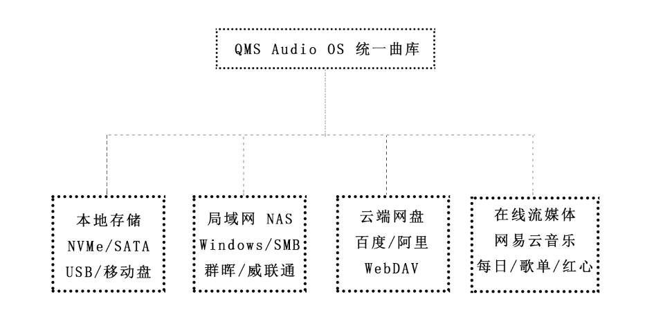

# 还原声音的本质：QMS Audio OS（七木发烧数播系统）全景技术白皮书与功能图谱

---

📺 **白皮书视频版，点击下方直接观看**：

<iframe src="//player.bilibili.com/player.html?bvid=BV1vcsH6EEJ8&page=1&high_quality=1&danmaku=0" scrolling="no" border="0" frameborder="no" framespacing="0" allowfullscreen="true" style="width: 100%; aspect-ratio: 16/9; border-radius: 12px; box-shadow: 0 4px 20px rgba(0,0,0,0.15); margin: 24px 0;"></iframe>

---

## 序言：为什么需要一款独立声学操作系统？

在传统 PC、智能电视或通用 Android 电视盒上播放音乐时，声音往往要穿透操作系统臃肿的多任务调度器、混音器（如 Windows DirectSound、Linux PulseAudio/PipeWire、Android AudioFlinger），被强制重采样、插值抖动与数字削顶。

**QMS Audio OS（七木发烧数播系统）** 应运而生。它不是一个挂载在普通操作系统上的播放器软件，而是一套**基于轻量 Linux 微内核与纯 C/C++ 语言深度定制、专为 Hi-Fi / Hi-Res 发烧声学而生的一体化独立嵌入式数播操作系统**。

QMS 从开机自检那一刻起，便全面锁死底层时钟抖动（Jitter），独占声卡硬件，实现真正的 **Bit-Perfect 源码比特直出** 与微秒级实时音频调度。

---

## 一、支持的全格式音频矩阵（Audio Formats Spectrum）

QMS 底层重写了解码与 I/O 调度中枢，对发烧圈现存的所有母带容器、镜像格式与编码标准提供全原生、全硬件级的直接推流支持：

### 1. DSD 原生母带全家族（Direct Stream Digital）

* **支持格式**：`.dsf`、`.dff`、`.iso`（SACD 光盘物理镜像）
* **采样规格**：
  * **DSD64** (2.8224 MHz / 1-bit)
  * **DSD128** (5.6448 MHz / 1-bit)
  * **DSD256** (11.2896 MHz / 1-bit)
  * **DSD512** (22.5792 MHz / 1-bit)
* **输出机制**：
  * **Native DSD 纯硬件直出**：自动握手 Amanero（意大利界面）、XMOS、ESS、AKM 等主流 USB DAC 芯片原生 Native DSD 接口；
  * **DoP 1.1 / DoP 2.0 无缝协商**：对未开放 Native 驱动的同轴/光纤或老款 DAC，自动采用 0 失真 DoP（DSD over PCM）帧打包输出；
  * **SACD ISO 内存扇区直接解算**：直接挂载播放几十 GB 的 SACD ISO 镜像，无需漫长解压拆包，内存扇区直接索引秒级播放。

### 2. PCM 极宽频无损音频全家族

* **支持格式**：
  * **FLAC**（Free Lossless Audio Codec，全压缩级别支持）
  * **WAV**（Linear PCM，无压缩无损母带）
  * **APE**（Monkey's Audio，支持 Fast、Normal、High、Extra High 全级别）
  * **AIFF / AIF**（Apple 演播室级原生音频格式）
  * **ALAC**（Apple Lossless Audio Codec，苹果无损音频格式）
  * **WV**（WavPack，发烧高压缩比无损）
* **量化规格**：
  * **位深**：16-bit（标准 CD 级）、24-bit（Studio 录音室母带级）、32-bit 整数与 32-bit IEEE 浮点母带；
  * **采样率**：44.1 kHz、48 kHz、88.2 kHz、96 kHz、176.4 kHz、192 kHz、352.8 kHz（DXD）、384 kHz、705.6 kHz 直至 **768 kHz** 极致超高采样。

### 3. CUE 虚拟精确分轨支持

* **整轨与分轨融合**：单文件整轨（如整张 CD 的 FLAC/APE/WAV）+ 关联 `.cue` 索引文件；
* **微秒级定轨跳转**：无需借助第三方软件预切，曲库自动解构为独立单曲呈现；
* **全字符集智能自适应**：支持 UTF-8、GBK、GB2312、Big5、Shift-JIS 字符集自省，彻底终结中文、日文发烧唱片乱码顽疾。

### 4. 常见压缩与广播流媒体格式

* **全兼容格式**：MP3（支持 CBR/VBR 最高 320kbps）、AAC、M4A、OGG Vorbis、WMA；
* **发烧转码缓冲流**：支持在向局域网智能电视或无线音响推流时，自适应转码为高码率 Linear PCM，消除外部设备兼容性障碍。

---

## 二、纯 C 声学 DSP 引擎与模拟听感仿真

QMS 拒绝任何引入延迟与失真的面条式代码，声学运算核心由精简纯 C 构建（`qms-engine`），具备硬件级的实时运算吞吐能力：

### 1. 六大经典名胆（真空管）物理仿真中枢 (`dsp_tube.c`)

通过在数学模型上模拟真空管特有的**纯偶次谐波（Second-Harmonic Distortion）**扩散分布与软饱和特性，让现代晶体管冷硬的声音染上黑胶黄金时代的温润感：

* **300B 梦幻之球**：被誉为“胆中之王”，中频醇厚通透，人声温润如玉，极具东方美学韵味；
* **KT88 磅礴帝王**：大动态推挽王者，低频下潜深沉如铁，管弦乐齐奏气势恢宏；
* **ECC83 (12AX7) 经典名品**：经典细腻的前级双三极管，声底甜美，高频丝滑悠扬；
* **2A3 清泉空灵**：音色清幽空灵，弦乐泛音极其丰富，微动态细节纤毫毕现；
* **EL34 英伦胆韵**：传统英国声代表，乐感浓郁饱满，中频富有人性化温度；
* **BYPASS 监听直通**：彻底绕过 DSP 算法芯片，0 着色、0 修正，追求最纯粹的录音室 Bit-Perfect 监听直出。
* *支持在播放过程中毫秒级热切换对比，听感即变，无需暂停打断音乐。*

### 2. 64-bit 双精度 10 段录音室专业 IIR 均衡器 (`dsp_eq.c`)

* 采用双二阶（Biquad）IIR 滤波器拓扑结构，全链路在 **64-bit 浮点**精度下解算；
* 覆盖发烧关键频点（31Hz、62Hz、125Hz、250Hz、500Hz、1kHz、2kHz、4kHz、8kHz、16kHz）；
* 具备防削顶裕量保护与一键平直归零机制，动态调节绝无爆音（Zero-Popping）。

### 3. 麦景图经典湖水蓝左右声道电平表 (`dsp_fft.c`)

* 实时计算左右声道的真实物理 **RMS（均方根）分贝电平**（-50dB ~ +3dB 动态包络）；
* 完美复刻世界殿堂级铭机“麦景图（McIntosh）”标志性的**湖水蓝双表头**指针摆动物理惯性；
* 搭配 1024 点快速傅里叶变换（FFT）实时声学频谱瀑布，带来视觉与听觉的双重发烧沉浸。

---

## 三、全域多模态曲库与网络存储中枢

QMS 彻底打破了“歌曲必须存在本地”的物理局限，构建起覆盖“本地 SSD、家庭 NAS、云端网盘、流媒体在线”的四维一体曲库：

1. **本地极速直连与热插拔**：
   * 支持 NVMe M.2 固态硬盘、SATA 固态/机械硬盘、USB 移动硬盘、U 盘；
   * U 盘即插即播，设备拔出瞬间驱动内核自动保护注销，杜绝死锁与文件损坏。
2. **局域网 NAS 智能自省与一键融合 (`qms-nas-discover` / `qms-nas-mount`)**：
   * 自动探测局域网内的 Windows 电脑共享、群晖（Synology）、威联通（QNAP）、极空间等 NAS 设备；
   * 支持 SMB/CIFS 与 NFS 协议，多盘多共享目录无缝聚合成统一曲库，自动补全封面与元数据。
3. **云端网盘免下载纯 C 直出推流 (`modules/cloud`)**：
   * 深度直连**百度网盘、阿里云盘、私有 WebDAV**；
   * **0 物理磁盘占用**：无需将几十 GB 的母带下载到本地，底层流式管道直接边拉取边推流，甚至支持云端网盘内的整轨 CUE 分轨点播。
4. **网易云千万级在线无损流媒体矩阵 (`modules/netease`)**：
   * 手机一键扫码安全登录；
   * 每日推荐 30 首无损母带、我喜欢的音乐、官方与个人精选歌单天地；
   * 支持“一键红心收藏”与手机端双向云同步。
5. **局域网拖拽极速拷歌 (`qms-local-share`)**：
   * 内置极速 Samba / ksmbd 文件服务；
   * 局域网内的任何电脑、手机无需借助 U 盘，在文件管理器里输入数播 IP，即可直接拖拽新专辑进硬盘。

---

## 四、双向音频推流与全宅互联（Dual-Way Cast Engine）

1. **无线接收端（数播作为发烧解码终端）**：
   * **苹果 AirPlay**：iPhone、iPad、Mac 手机控制中心一键直投，高保真无损接收；
   * **安卓 / 国内音乐 App DLNA**：QQ音乐、酷狗、酷我、网易云等 App“投送/QPlay”一键串流至 QMS 解码直出。
2. **无线发射端（数播作为局域网音频中枢）**：
   * 自动发现局域网内的智能音响、DLNA 电视与网络功放；
   * 将数播内的高清曲库无缝分发串流至全宅各个房间。

---

## 五、物理隔离双端流体 UI 与动态歌词中枢

QMS 坚持“大屏专业多任务，移动触控轻奢化”的设计哲学，两端在物理架构上绝对隔离：

* **PC / 平板专业桌面端 (`index.html`)**：
  专为宽屏设计的发烧控制台，拥有完整的三栏曲库树、动态频谱大舞台、深度存储映射管理与流媒体多任务协同。
* **手机移动轻奢触控端 (`v2.html`)**：
  为单手触控量身打造，拥有自适应专辑流体卡片墙、旋转黑胶唱机动效、全屏麦景图湖水蓝双表头，优雅掌控全盘。
* **发烧级动态歌词引擎 (`modules/lyrics`)**：
  * 支持歌曲内嵌 ID3/FLAC 歌词解析；
  * 同目录 `.lrc` 文件毫秒级精准对齐；
  * 网络动态歌词自适应补全；
  * 流体卡拉OK逐字平滑渐变滚动，大舞台绝对几何居中。

---

## 六、硬件级发烧安全防线与底层工控优化

* **开机微光仪式与硬件防爆音守护 (`qms-bootsplash`)**：开机阶段彻底锁定 DAC 输出继电器，压制开机脉冲电流，消灭音箱“轰鸣爆破音”，伴随深邃微光声学开机仪式平稳唤醒；
* **硬件级音量平滑控制 (`qms-volume`)**：彻底脱离粗暴数字衰减导致的动态压缩，采用对数感知曲线调节，保障高动态范围与低信噪比；
* **全平台免驱兼容性**：
  全面兼容 x86_64 平台主流架构（Intel NUC、工控迷你机、HP T620、索泰 ZBOX、苹果 Mac mini、主流家用 PC 等）；
  免驱支持市售 99% 的 USB DAC 声卡与专业数字界面；
* **达菲（Daphile）双系统同盘共生**：支持在单张固态硬盘上实现 QMS 与 Daphile 极速秒切与共存，曲库共享，满足多元发烧调音探索。

---

## 结语：献给对音质绝不妥协的爱乐者

QMS Audio OS 秉持**“删繁就简、直达声学本质”**的工程理念，将计算机软硬件复杂的层层阻隔彻底击穿，让音乐数据以最原本、最纯净的姿态直达您的解码器。无论是幽微的人声叹息，还是交响乐席卷而来的瞬态洪流，QMS 始终以发烧之名，为您守护每一个跳动的音符。
