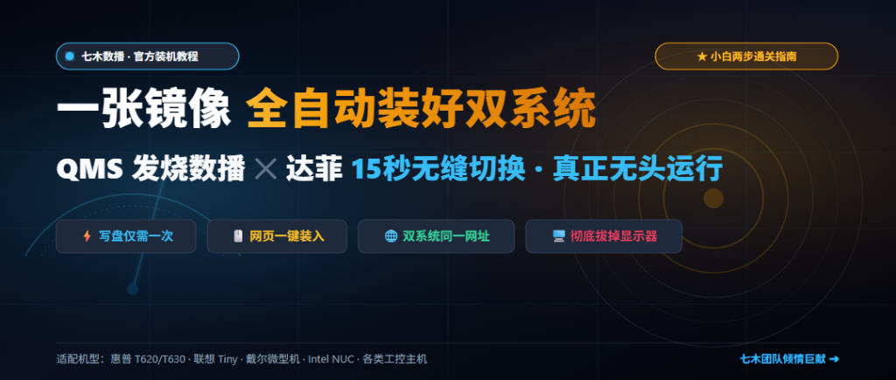
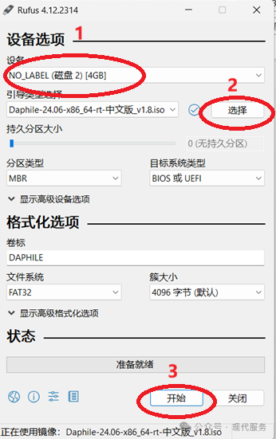
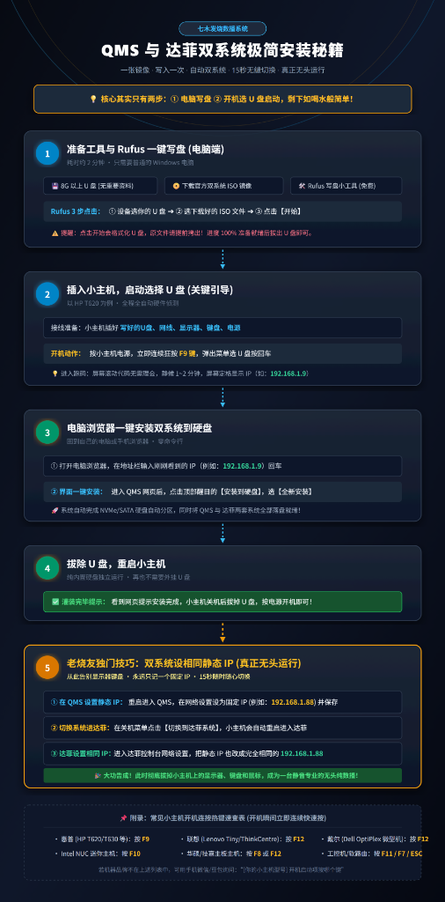

# 一张镜像全自动装好双系统！QMS 发烧数播 × 达菲极简安装秘籍

> **导语**：  
> 自从七木团队推出 **【QMS Audio OS × 达菲（Daphile）双系统】** 以来，我们收到了大量发烧友与乐友的热情反馈。很多动手能力强的老烧友顺顺利利装好并开声，也有不少新入坑的朋友希望能有一份**“大白话、零门槛、一步步照着点”**的官方极简安装教程。  
> 
> 应广大用户的呼声，今天特意为大家梳理出这份极简装机指南。**其实核心关键就两步：1 是电脑写盘，2 是开机选 U 盘引导**。只要这两步走顺了，剩下的安装比喝水还要简单！



---

## 一、准备工作

在开始之前，请确认手头准备好以下 5 件套工具：

1. **一只 U 盘**：容量建议在 **8GB 或以上**（写盘会清空数据，请确保 U 盘内无重要资料）；
2. **一台 Windows 电脑**：用于下载镜像并制作启动 U 盘；
3. **一个双系统官方 ISO 镜像文件**；
4. **免费写盘小工具**：推荐使用成熟小巧的 **Rufus**（或 Ventoy）；
5. **一台用于安装双系统的小主机**：如经典的惠普 HP T620、T630、联想 Tiny、戴尔微型机或各类工控机，并临时连接好显示器、键盘、网线与电源。

---

## 二、下载官方 ISO 镜像文件

您可以选择以下任意一种方式获取最新的双系统官方镜像：

👉 **网站专属高速分流通道**：  
**[点击这里直接访问百度网盘下载 QMS × 达菲双系统官方镜像](https://pan.baidu.com/s/1j445htW_LeFTTpcvyGT-cQ?pwd=qmsb)**
* **网盘提取码**：`qmsb`

👉 **公众号推文通道**：  
您也可以阅读我们的微信公众号官方发文：  
[【重磅发布】七木发烧数播 v5.5.0 PRO 达菲双系统官方安装教程！一张镜像，两套系统，15秒无缝切换](https://mp.weixin.qq.com/s/yqUFsqOPoDEDCIRg3bLeNw)，在文章置顶评论区中同样可以获取专属网盘下载链接。

---

## 三、Rufus 一键写盘（约 2 分钟）

在 Windows 电脑上下载并双击打开 **Rufus** 写盘软件，界面如下图所示，只需顺次确认 **3 个红圈标号**：



1. **红圈 1（设备）**：下拉菜单中精准选中您插上的 **U 盘**；
2. **红圈 2（选择）**：点击右侧的【选择】按钮，找到您刚刚下载好的 **双系统 ISO 镜像文件**；
3. **红圈 3（开始）**：点击下方的【开始】按钮即可开始全自动写盘。

> ⚠️ **重要提醒**：点击【开始】之前，务必再次确认该 U 盘里的个人重要文件已经备份，因为写入过程会格式化清空 U 盘！写入进度条到达 100% 后，拔出 U 盘即可。

---

## 四、插入小主机，启动选择 U 盘（关键引导步骤）

将写好镜像的 U 盘插入您准备安装的小主机（以最经典的 **HP T620** 为例），接上网线、显示器、键盘与电源。

### 1. 开机动作（狂按引导热键）：
* 接通小主机电源或按下开机键后，**立刻连续疯狂轻敲键盘上的 `F9` 键**；
* 直到屏幕弹出**启动菜单（Boot Menu）**，在列表中用上下方向键选中您插入的 **U 盘**，按下回车键（Enter）。

### 2. 常见品牌小主机开机按键速查表：

不同品牌的主机进入快捷启动项的按键有所不同，请对照下表操作：

| 主机品牌 / 机型 | 开机需连续狂按的热键 |
| :--- | :---: |
| **惠普 (HP T620 / T630 / 瘦客机)** | **F9** |
| **联想 (Lenovo Tiny / ThinkCentre)** | **F12** |
| **戴尔 (Dell OptiPlex 微型机)** | **F12** |
| **Intel NUC 迷你主机** | **F10** |
| **华硕 / 技嘉主板主机** | **F8** 或 **F12** |
| **各类工控机 / 软路由小主机** | **F11** / **F7** / **ESC** |

*(若您的主机品牌不在上述列表中，可用手机通过豆包或搜索引擎直接查询：“[您的主机型号] 开机启动项按哪个键”)*

### 3. 静候 IP 地址显示：
选中 U 盘回车后，屏幕会滚动加载 Linux 内核代码，**此时什么都不用动，静静等待 1~2 分钟**，直到屏幕定格并显示一个明显的局域网 IP 地址，例如：
```text
http://192.168.1.9
```

---

## 五、电脑浏览器一键安装双系统到硬盘

当你从小主机屏幕上看到分配的 IP 地址（如 `192.168.1.9`）后：

1. 回到您自己的 Windows 电脑或手机上，打开任意浏览器（Edge、Chrome 等）；
2. 在浏览器最上方的网址地址栏中输入小主机屏幕上看到的 IP：`192.168.1.9` 并按回车；
3. 此时网页端会瞬间加载出 **QMS 音频控制台**，界面顶部会有一条醒目的装机提示；
4. 点击提示中的 **【安装到硬盘】**，在弹出的窗口中选择 **【全新安装】**（选择您小主机的内置固态硬盘即可）；
5. 系统将全自动完成 NVMe/SATA 硬盘自动分区，同时将 QMS 与达菲两套系统全套灌装就绪，整个过程仅需数十秒！

---

## 六、结束安装，拔出 U 盘

当网页端提示“安装完成，请重启系统”后：

1. 将小主机彻底关机；
2. **拔出写盘用的 U 盘**；
3. 重新按下小主机电源键开机，此时主机将直接从小主机内置硬盘独立启动，再也不需要外挂 U 盘！

---

## 七、老烧友独门使用技巧：双系统设相同静态 IP，实现真正“无头运行”

系统重启后，默认会再次进入 QMS 系统。为了后续切换两套系统不用反复查 IP、彻底扔掉显示器和键盘，老烧友强烈推荐以下**“双系统同 IP”**操作：

1. **在 QMS 里设置静态 IP**：  
   进入 QMS 网页端 ➔【系统设置】➔【网络设置】，将自动 DHCP 改为 **固定静态 IP**（例如设定为 `192.168.1.88`），保存生效；
2. **切换系统到达菲**：  
   在 QMS 关机/退出菜单中，点击 **【切换到达菲系统】**，小主机会在 15 秒内自动安全重启并进入达菲（Daphile）；
3. **进入达菲并锁定相同 IP**：  
   由于达菲初次启动仍是 DHCP，观察显示器上的新 IP（或在路由器后台查看），在浏览器输入该 IP 进入达菲控制台；  
   进入达菲的 `Settings ➔ Networking`，把 IP 同样手动修改为刚刚在 QMS 里设置的相同地址：**`192.168.1.88`**，保存并重启！
4. **大功告成，彻底拔掉显示器与键盘**：  
   达菲重启后，屏幕上依然会稳定显示 `192.168.1.88`。**到此为止，你就可以把小主机上的显示器、键盘鼠标全部拔掉**！无论你切换到 QMS 还是达菲，在手机或电脑浏览器里永远只需要输入这一个固定的 IP（如 `192.168.1.88`），真正化身为一台安静、纯粹、专业的无头（Headless）发烧数播专机！

---

## 八、全流程一览图（欢迎保存收藏）

所有过程其实非常纯粹，只要搞定“电脑写盘”和“开机引导”，剩下全由自动化程序处理。大家可以保存下方这张长图流程秘籍，随时对照实操：



---

## 💬 专属售后与技术支持

如果您在安装、引导热键、声卡直通或双系统切换过程中遇到任何疑问，欢迎随时与我们交流：

* 微信一对一交流与进群：添加站长微信 **`wxcq888`**（备注：双系统安装）
* 欢迎关注公众号【老机复活】与【七木数播】，获取更多发烧系统调校与音乐资源！

**祝各位烧友装机顺遂，听音愉快，频出好声！** 🎶
