# 让海量发烧母带一秒归位！七木数播 QMS v5.6.1 震撼引入 AI 智能曲库洗牌工坊

> **导语**：  
> 七木数播 QMS 再次迎来重磅固件升级！立志于打造国内顶尖的发烧级数播系统，最新的 **v5.6.1-PRO** 版本带来了一项革命性的发烧黑科技——**彻底攻克困扰无数发烧友多年的“曲库标签混乱、单曲散落、找不到歌手”的陈年痛点！**

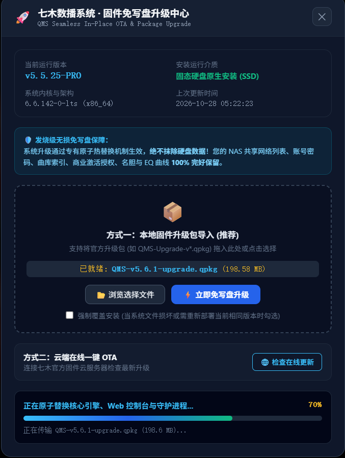

平时我们从网盘转存、论坛下载或朋友处拷来的数万首无损母带，标签往往五花八门：歌名被误当成了歌手、整张合辑塞在歌手列表里、或者歌手全是乱七八糟的数字代号。

这一次，QMS 创新接入云端前沿 AI 大模型能力，重磅推出 **【AI 智能曲库洗牌工坊】**！让高维大模型根据曲库上下文精准识别演唱者，把上千首散落单曲瞬间归位到真正的发烧名家名下！

---

## 🛡️ 【三大发烧安心保障】

1. **🔒 100% 本地隐私闭环**：  
   用户自备 API Key 直连大模型官方服务器，系统无任何第三方数据转存，曲库与机密隐私绝对安全；
2. **💰 超低成本白菜价**：  
   实测清洗 **2,000 首** 长尾单曲仅花费 **¥0.24（两毛四分钱）**，充值 10 元足够高频洗牌用上数年；
3. **⚡ 内存级极速响应**：  
   QMS 独家内存单例索引，洗牌完毕即刻全量生效，系统丝滑不卡死、边听边洗零抖动。

---

## 🛠️ 保姆级实战操作指南

### 第一步：唤出【AI 曲库洗牌工坊】
进入 QMS PC 桌面端控制台的 **【歌手分类】** 视图，在顶部工具栏点击闪耀的 **【🤖 AI 曲库洗牌】** 按钮呼出控制中心。

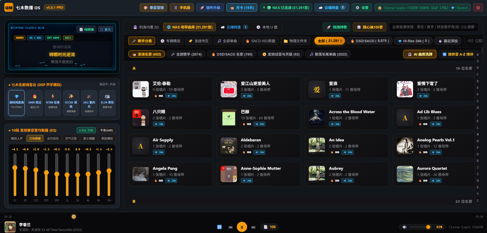

---

### 第二步：选择大模型服务商
在弹出的【QMS AI 智能曲库洗牌工坊】窗口中选择大模型服务商。

目前国内大模型调用需用户自备 API Key（由大模型官方按调用字数微额计费，QMS 官方绝不加收任何中间费用）。强烈推荐选用 **【DeepSeek (深度求索)】**，中文推理精准度极高且成本极其低廉。在下拉框选中 DeepSeek，随后点击右侧的 **【🔗 获取 DeepSeek API Key】** 前往官方开放平台。

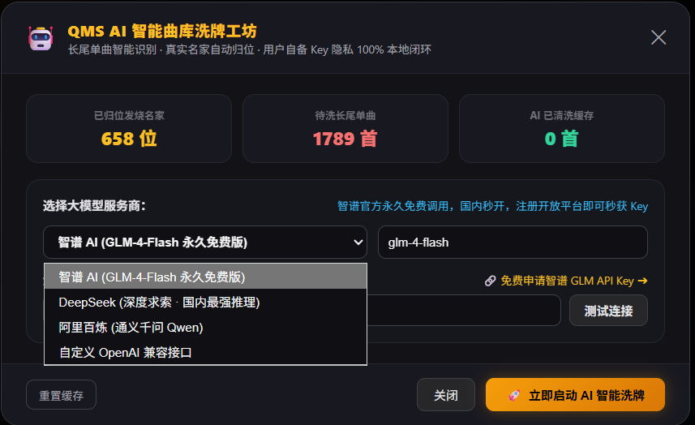

---

### 第三步：进入 DeepSeek 开放平台并注册登录
进入 DeepSeek 官方网站后，点击顶部右上角的 **【API 开放平台】**（如下图红色箭头所示）。

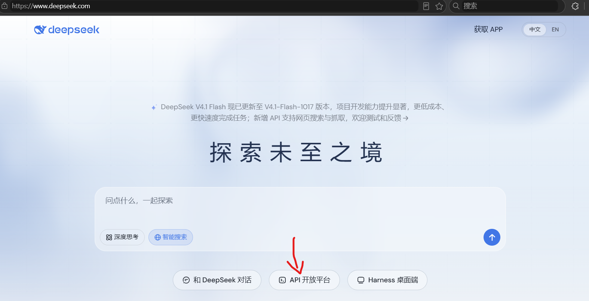

输入您的常用手机号码，获取短信验证码即可秒级完成注册与登录。

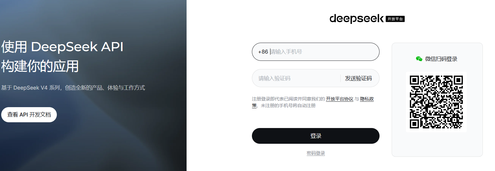

---

### 第四步：微额充值（10元可用数年）
登录后进入控制台的充值页面，**建议充值 10 元人民币即可**。

大模型 API 计费极其便宜，实测清洗 2,000 首长尾母带仅需 ¥0.24（不到三毛钱！），这 10 元额度足够洗牌数十次、用上很长时间。

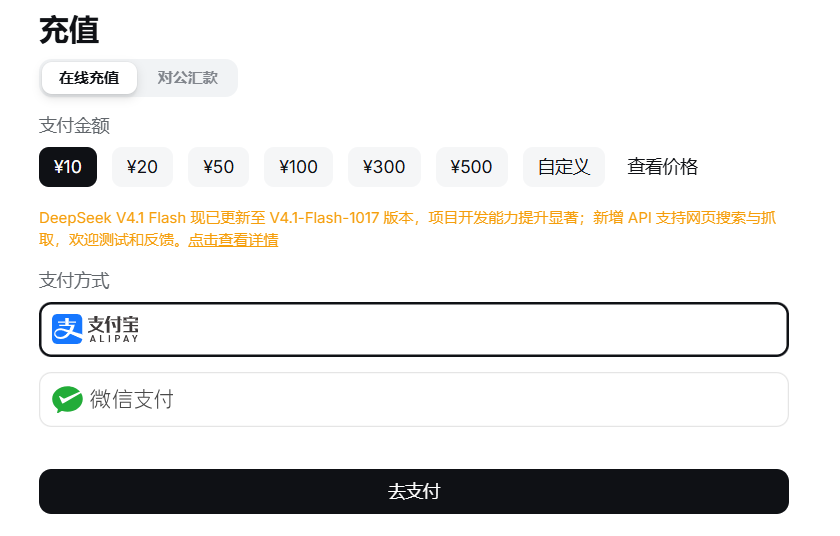

---

### 第五步：创建并复制 API Key
在左侧导航栏点击 **【API Keys】**（标记 1），随后点击右侧的 **【创建 API key】** 按钮（标记 2）。

在弹出窗口中随意填入一个名称（例如输入“qms”），确认后即可生成一串以 `sk-` 开头的专属密钥。点击 **【复制】** 按钮，然后返回七木数播控制台页面。

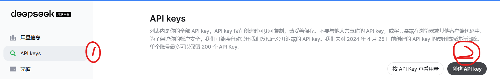

---

### 第六步：填入密钥并测试握手连接
将刚才复制的密钥粘贴到 QMS 的 **【大模型 API Key（密钥）】** 输入框中，点击右侧的 **【测试连接】** 按钮。

如果密钥与额度正常，系统顶部将弹出绿色提示：**【✓ API 授权验证通过！大模型通道已畅通】**，表明安全握手完成。

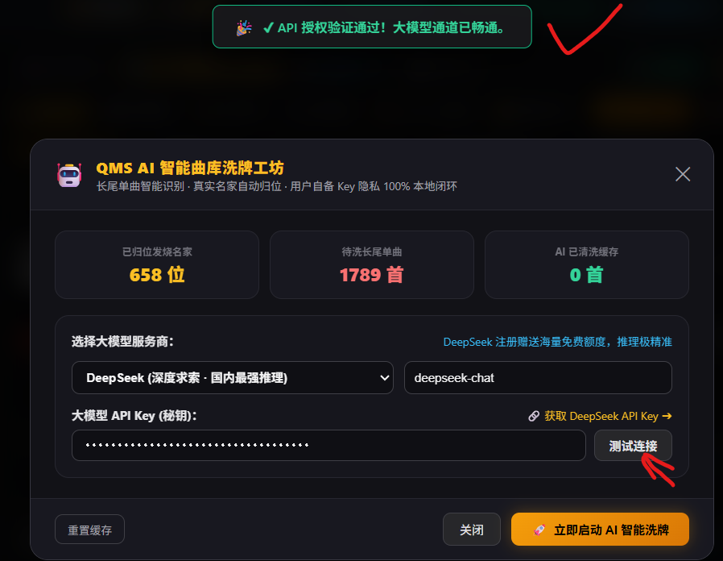

---

### 第七步：启动洗牌，秒级精准归位
万事俱备！点击底部的 **【🚀 立即启动 AI 智能洗牌】** 按钮，QMS 将自动分批提取散落长尾单曲，送入大模型进行多维语义分析与精准归位。

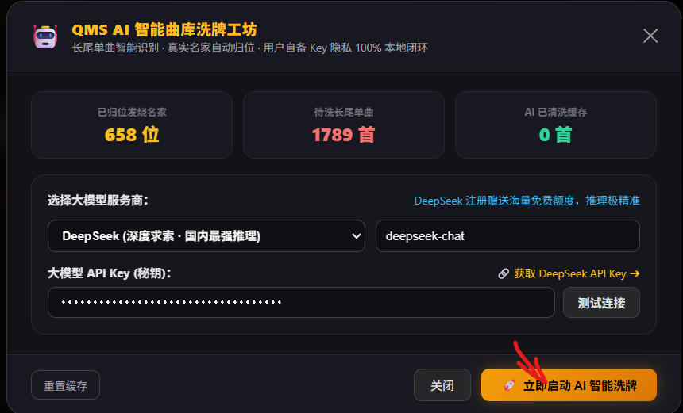

在黑客级实时日志终端中，您可以清晰看到大模型精准推理解析的过程：如将《红豆词》智能归位于【邓丽君】、《红楼梦》归位于【陈淑桦】、《红豆红》归位于【龙飘飘】，每一条都有据可查，纯净透明。

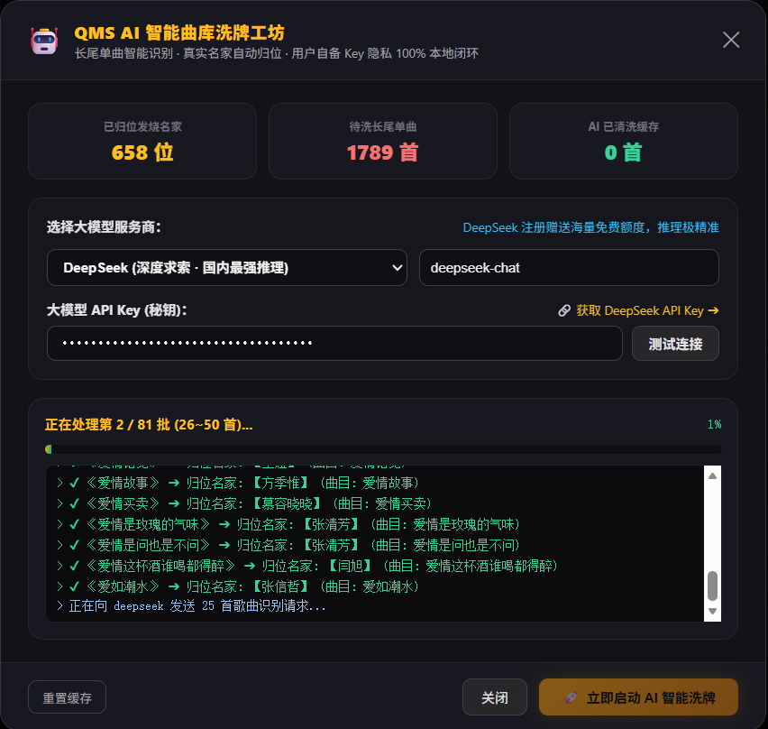

处理时间视待洗曲目数量而定，一般数千首长尾歌曲只需 **2～3 分钟** 即可全量洗牌完成！

洗牌完毕后，QMS 将在毫秒级内自动刷新曲库索引，纯粹发烧名家瞬间呈现！

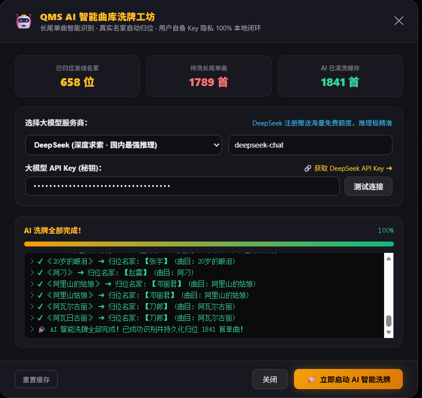

---

## 📥 获取与下载通道

👉 **[点击这里直接访问百度网盘下载 QMS Audio OS 系统镜像与升级包](https://pan.baidu.com/s/1j445htW_LeFTTpcvyGT-cQ?pwd=qmsb)**
* **网盘提取码**：`qmsb`

### 升级与新装指引：
* **已装老用户（在线 OTA / 本地升级包）**：  
  已安装 QMS 的老用户可从网盘直接下载 `QMS-v5.6.1-upgrade.qpkg` 专属升级包，进入控制台【固件升级】一键上传导入，通过底层专有原子替换机制无感生效，**绝不抹除硬盘原有曲库与个人配置**！
* **新用户全新装机**：  
  下载网盘中的官方全新安装 ISO 镜像，使用 Rufus 或 Ventoy 写入 U 盘，插上小主机引导即可 1 分钟完成全自动自动化装机。
* **商业授权与专属技术支持**：  
  如需获取终身激活授权、进入专属发烧研讨群或预约一对一技术协助，可添加站长微信：**`wxcq888`**。

---

> 🎵 **七木声学实验室 敬上**  
> *科技赋能声学，让每一首珍藏母带都井然有序、发烧动听！*
