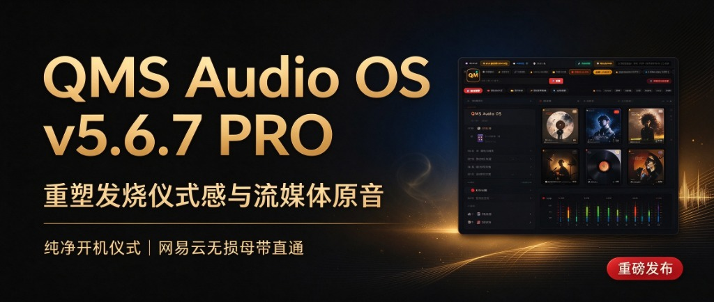
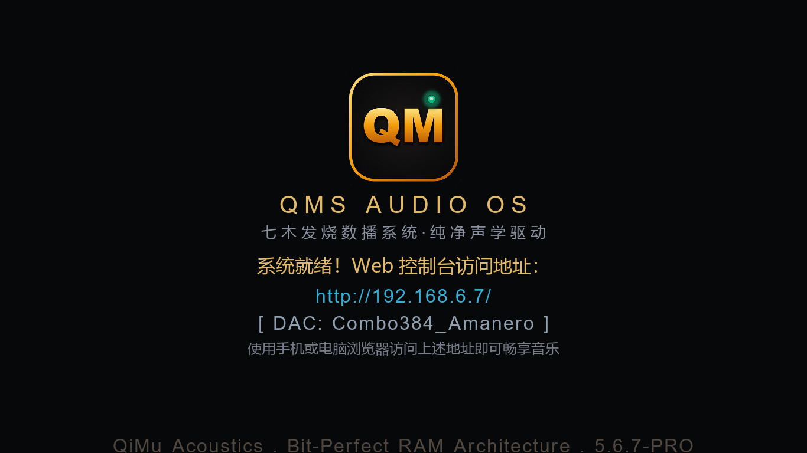

# 重塑发烧仪式感与流媒体原音｜七木数播系统 QMS Audio OS v5.6.7 PRO 重磅发布

> **“让冷冰冰的代码隐于黑暗，让温暖的音乐浮现眼前。”**  
> 历经数十个日夜的声学算法淬炼与系统底层架构重构，今天，七木数播团队正式向全球乐友推送 **QMS Audio OS v5.6.7 PRO 官方旗舰版固件**。
>
> 这一次，我们打破了“传统数播系统只是工具”的陈旧观念，带来了两大划时代的核心升级：**百万级旗舰数播专属纯净开机仪式**，以及**网易云音乐千万发烧母带无损直通生态（手机扫码即登）**。

---

## 亮点一：开机即惊艳 —— 百万级旗舰专属纯净开机仪式

对于真正的声音鉴赏家而言，聆听的快感，绝不仅仅始于声波撞击耳膜的那一秒，而是从指尖按下电源键的那一刻起，便已悄然开启。

以往基于 PC 或嵌入式架构的数播系统，开机时往往充斥着 Linux 内核滚屏跑码、杂乱的 BIOS 自检信息与冰冷的英文提示，瞬间破坏了整套 Hi-Fi 系统的发烧雅兴。

在 **v5.6.7 PRO** 中，七木声学实验室彻底重构了开机底层显示渲染管线与硬件静音时序：

* 🌑 **告别跑码，深邃纯黑**：摒弃传统系统的杂乱文本输出，深度定制硬件级纯黑静寂背景；
* ✨ **发烧微光呼吸徽标**：伴随着电源接通，标志性的黄金比例琥珀微光与七木发烧徽标在黑屏中央优雅浮现，如名胆灯丝初启般柔和呼吸；
* 🛡️ **硬件级防爆音静音时序**：开机过程中全程保持声卡静音锁闭，严密杜绝电平跳变引起的冲击杂音，保护您昂贵的后级功放与高灵敏音箱；
* ⚡ **极速声学就绪**：无需漫长等待，数十秒内静默完成专核声学推流架构、内存虚拟盘（RAM-Disk）与麦景图真实电平表头通道的初始化，开机即是巅峰状态。

---

## 亮点二：手机扫码，一触即发 —— 网易云音乐千万发烧母带无损生态上线

无数乐友曾对我们倾诉：“如果能在七木数播那台拥有 6 大名胆仿真与麦景图真实双表头的发烧神机上，一键点播我手机网易云里珍藏多年的红心歌单，该有多惬意？”

今天，这一愿望在 **v5.6.7 PRO** 中完美成真！我们绝不妥协于常规安卓数播的 SRC 劣质重采样或蓝牙有损压缩，而是打通了**网易云官方无损微服务与 QMS 纯 C 声学引擎的直连高速公路**：

### 1. 📱 手机网易云 App 扫码即登，免密持久直通
无需在数播屏幕上繁琐地输入账号密码！在控制台或手机流体轻奢端轻轻一点，调出高质感扫码弹窗，**拿起手机打开网易云音乐 App 轻轻一扫，2 秒内自动完成授权**。一次扫码，长期免密免签，黑胶 VIP 权益即刻激活！

### 2. 📅 每日专属私享推荐（Daily Songs）
每日清晨，根据您的听歌品味个性化推流专属 30 首母带。配备醒目的**“▶ 一键播放全部”**红色大胶囊按钮，从晨间古典到黄昏爵士，无需选歌，一键开启整日的发烧听觉盛宴。

### 3. ❤️ “我喜欢的音乐”私人珍藏下潜
多年来在手机上积攒的上千首红心歌曲，自动秒级加载进发烧控制台。呈现完整专辑大封面、歌手、采样率与歌曲时长，熟悉的旋律在顶级推流引擎的解算下焕发新生。

### 4. 📁 我的发烧歌单与精选试音碟墙
无论是您自建的“发烧女声毒物”、“雨果交响测试”，还是官方精心整理的“柏林之声试音典范”、“SACD 人声天碟”，全部以流体唱片墙网格优雅呈现。支持单曲点播与整张专辑连续推流。

### 5. 💖 双向实时红心同步（Tap to Like）
听歌时偶遇直击心灵的旋律，在歌曲列表或底栏随手点亮红心 ❤️，**毫秒级双向同步至网易云官方服务器**。手机 App 即刻同步点亮红心，让发烧器材与移动生活完美合二为一。

### 6. 🔥 独家声学黑科技注入：名胆偶次谐波重塑数码流
所有来自网易云的 FLAC 与 24-bit/96kHz Hi-Res 源码音频流，直接注入 QMS 专核推流中枢：
* **100% 尊享 300B、KT88、ECC83 等 6 大名胆仿真**，彻底褪去流媒体的数码干冷生硬，赋予人声黑胶般的温润与松香味；
* **麦景图真实分贝表头跟随**：-50dB ~ +3dB 声学指针根据实际音频能量毫秒级起舞，听觉与视觉双重沉浸。

---

## 升级一览表与全景对比

| 体验维度 | 传统数播 / 旧版体验 | QMS Audio OS v5.6.7 PRO |
| :--- | :--- | :--- |
| **开机启动** | Linux 滚屏跑码、英文报错、冷冰生硬 | **深邃纯黑、微光呼吸徽标、防爆音静音守护** |
| **在线流媒体** | 仅支持本地硬盘或局域网 NAS | **网易云千万级 Hi-Res / 无损母带全量直通** |
| **账号登录** | 需接键盘输入账号密码，易掉登录 | **手机网易云 App 扫一扫即登，长效免密** |
| **歌单生态** | 手动拷贝音频文件，管理繁琐 | **每日推荐、我喜欢、自建歌单、精选试音全覆盖** |
| **收藏同步** | 离线孤岛，无法与手机互动 | **实时双向点亮红心，手机端即时同步更新** |
| **推流音质** | 软件播放器简陋解码，数码味重 | **纯 C 源码直出 + 6大名胆纯偶次谐波 + 真实电平表头** |

---

## 📥 官方系统镜像与升级包下载通道

👉 **[点击这里直接访问百度网盘下载 QMS Audio OS 系统镜像与升级包](https://pan.baidu.com/s/1j445htW_LeFTTpcvyGT-cQ?pwd=qmsb)**
* **网盘提取码**：`qmsb`

---

## 🛠️ 升级方式（官方免写盘一键升级）

所有正在使用 QMS Audio OS（包括 Mac mini、HP T620、联想工控机及各类发烧整机）的用户，均可享受本次全新升级：

1. **获取官方升级包**：从上方百度网盘下载 `QMS-Upgrade-v5.6.7-PRO.qpkg`（或 `QMS-v5.6.7-upgrade.qpkg`）；
2. **免写盘一键安装**：进入 Web 控制台顶部点击 **【🚀 固件升级】**，上传固件包，系统将在 15 秒内自动全量沙箱检验并无缝部署，原有曲库、NAS 挂载与名胆参数 100% 完好保全；
3. **享受全新界面**：升级完成后，在浏览器按 **`Ctrl + F5`**（苹果 Mac 电脑按 **`Cmd + Shift + R`**）强制刷新页面，即可拥抱全新声学视界！
4. **新装机用户**：可从百度网盘下载全新安装 ISO 镜像，使用 Rufus 或 Ventoy 工具一键写入 U 盘启动即可全自动装机。
5. **商务合作与技术咨询**：如需加入发烧乐友研讨群或获取商业版授权，欢迎添加站长微信：**`wxcq888`**。

---

> **七木数播团队寄语：**  
> “数播的终极归宿，不是堆砌参数，而是唤醒耳朵对音乐最初的感动。”  
> 感谢每一位同行乐友的热爱与支持。QMS Audio OS v5.6.7 PRO 现已全面推送，欢迎即刻升级，开启属于您的云端私享音乐盛宴！
